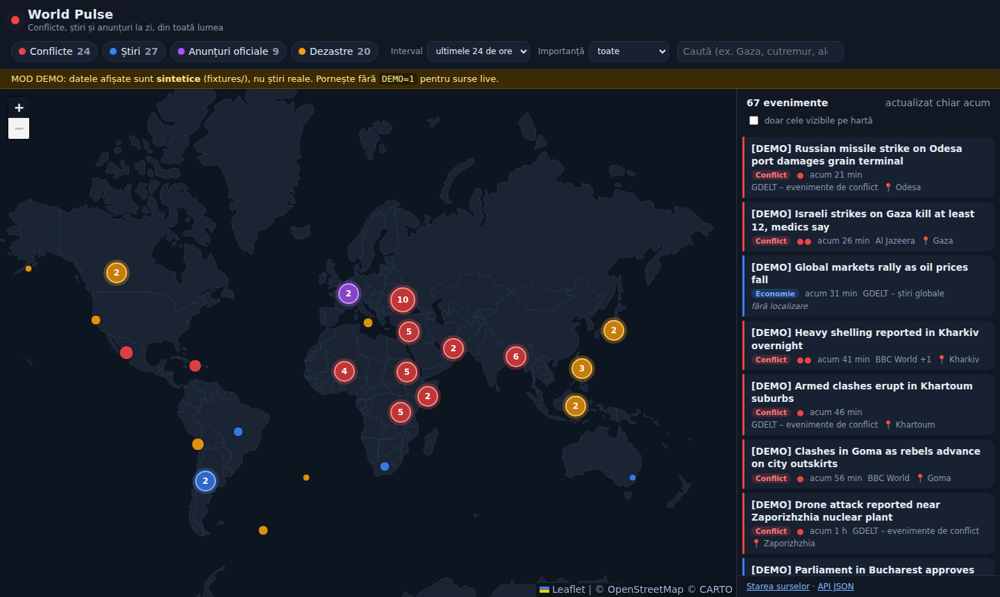

# World Pulse

A continuously updated global map with **four layers**:

| Layer | Contents | Default sources |
|---|---|---|
| **Conflicts** | fighting, attacks, shelling, ceasefires, military tension | **GDELT Events** (15-minute export, geolocated), GDELT DOC API, plus any news item classified as "conflict" |
| **News** | current news from every country | GDELT per country (~200 queries), 657 RSS feeds in total (149 for Europe, see below), including BBC, Al Jazeera, Guardian, DW, France 24, NPR, NYT |
| **Official announcements** | press releases from international organizations | UN News, WHO, ReliefWeb, European Commission and Parliament, NATO, OSCE |
| **Disasters** | earthquakes, floods, cyclones, wildfires, eruptions | USGS, GDACS, NASA EONET |

An independent project with zero npm dependencies: Node >= 18 plus a static frontend with D3 bundled
locally in `public/vendor/`. The interface is a 3D globe (D3 orthographic projection, no map tiles and no
API key). Conflicts, disasters and official announcements appear as points at their real location; news
is shown as a choropleth (color per country by number of items, click a country to see its list on the right).



## Quick start

```bash
npm start            # live sources   -> http://localhost:8080
npm run demo         # synthetic data from fixtures/, no network
npm test             # node:test suite
```

Environment variables: `PORT` (8080), `HOST` (0.0.0.0), `DEMO=1`, `MAX_AGE_HOURS` (72),
`GDELT_REGIONS` (all by default; e.g. `europe,africa`).

Related social media posts (optional; without them, the "Show related social posts" button on an event
page simply shows "no results", with no error):

- `BLUESKY_IDENTIFIER` + `BLUESKY_APP_PASSWORD`: a free Bluesky account plus an app password
  (bsky.app -> Settings -> App Passwords). Required because `app.bsky.feed.searchPosts`, unlike other
  public Bluesky endpoints, answers 403 without authentication (checked directly).
- `YOUTUBE_API_KEY`: a free API key from the Google Cloud Console (YouTube Data API v3 enabled).
  The free quota is 10,000 units/day and a search costs 100, so roughly 90 searches/day (internal cap in
  `src/lib/social.js`). It is called ONLY on demand (when a user opens an event), never in the
  background aggregation loop.

On a server, these variables do NOT go into `deploy/install.sh` (they would end up in git). Put them in
a local file outside `$APP_DIR` (which is rewritten on every deploy), by default `$DATA_DIR/secrets.env`
(e.g. `/var/lib/world-pulse/secrets.env`), in `KEY=value` format, one per line. `install.sh` reads it
automatically if it exists, on every install.

Checking sources on the server (recommended after each new batch):

```bash
npm run check-sources -- --region europe                    # OK / empty / error report for every source
npm run check-sources -- --region europe --disable-failing  # disables the failing ones in sources.local.json
```

Research on global sources and the staged plan (continent -> country): [docs/SOURCES.md](docs/SOURCES.md).
A single collection pass, without the server: `node src/aggregator.js`.

## How it works

```
sources (RSS / Atom / GeoJSON / JSON)
   |  src/lib/http.js        fetch with timeout, retry, 6 s pause between GDELT requests
   v
adapters (src/sources/adapters.js)   rss, gdacs, gdelt-doc, gdelt-events, usgs, eonet
   v
makeEvent (src/lib/normalize.js)
   |- classify.js   -> category (conflict/disaster/health/politics/economy/general) + severity 0-3
   |- geo.js        -> geolocation from text (201 countries + 216 hand-picked places + 11,903 GeoNames cities)
   '- layers        -> a news item about a conflict also appears in the "Conflicts" layer
   v
Store (src/store.js)   dedup (canonical URL + normalized title), 72 h retention, persisted in data/cache.json
   v
server.js   /api/events, /api/sources, /api/health, static files
   v
public/app.js   D3 globe (points for conflicts/disasters/official, choropleth for news), side feed, filters
```

**Geolocation** (`src/lib/geo.js`) follows one simple rule that matters a lot: *the place beats the actor*.
In "Israeli strikes on Gaza" or "Ukrainian drones hit Moscow", the city wins over the demonym.
Priority is concrete place > country name > demonym, and on a tie the first occurrence in the text wins.
Short acronyms (UK, US, DRC) match only when written in capitals. Events located only at country level get
a small offset on the map so they do not all pile up on the centroid.

**Gazetteer.** `src/data/places.js` holds 201 countries (ISO2, English name, centroid, alternative names
and demonyms in several languages) and 216 hand-picked places (cities, regions, sea areas). It is
complemented by `src/data/geonames.js`, generated by `scripts/build-geonames.js` from GeoNames
`cities15000` (population >= 15,000): 11,903 cities across 188 countries. The GeoNames population is used to
prefer the more notable place when two real places share a name (e.g. Paris, FR vs Paris, US-TX).

**Classification** (`src/lib/classify.js`) uses keyword lists in five languages (EN, RO, FR, ES, DE), so
it stays transparent and easy to tune. Severity 3 means a conflict or disaster with casualties. For
disasters, severity comes from the source: GDACS level (green, orange, red) or USGS magnitude.

## API

`GET /api/events` with optional parameters:
`layers=conflict,news,official,disaster` / `hours=1..720` (default 24) / `q=text` / `country=UA` (ISO2) /
`minSeverity=0..3` / `geo=1` (only items with coordinates) / `limit` (default 3000).

```json
{
  "id": "8ca90889c192d329",
  "title": "...", "summary": "...", "url": "https://...",
  "layers": ["conflict", "news"], "category": "conflict", "severity": 3,
  "lat": 49.99, "lon": 36.23, "country": "UA", "place": "Kharkiv", "geoPrecision": "city",
  "publishedAt": "2026-09-27T17:10:00.000Z", "fetchedAt": "...", "lang": "en",
  "sources": [{ "id": "bbc-world", "name": "BBC World" }, { "id": "aljazeera", "name": "Al Jazeera" }]
}
```

`geoPrecision` can be `exact` (coordinates from the source), `city`, `country` or `none` (shown only in the feed).
`GET /api/sources` returns the status of each source: last run, last error, number of items fetched.

## Source inventory

865 sources are loaded by default: 657 RSS feeds (each with its own URL), 204 GDELT DOC queries
(one per country plus a few thematic ones), 1 GDELT Events export, and one each of USGS, GDACS and
NASA EONET.

| Region (`src/sources/`) | RSS feeds | Marked `verified: false` |
|---|---|---|
| Europe (`europe.js`): 45 countries + EU institutions | 149 | 149 |
| Middle East (`middle-east.js`) | 51 | 51 |
| Africa (`africa.js`) | 118 | 118 |
| Americas (`americas.js`) | 139 | 0 (all `verified: true`) |
| Asia (`asia.js`) | 89 | 0 (all `verified: true`) |
| Oceania (`oceania.js`) | 88 | 37 |
| Global (`index.js`: BBC, Al Jazeera, UN News, WHO, ReliefWeb, Crisis Group, ...) | 23 | 0 (11 carry no flag) |
| **Total** | **657** | **355** |

The 355 feeds with `verified: false` come from public lists and publisher websites, but could not be
downloaded when they were added.

## Server installation

On the server, as root. The script clones this public repo directly:

```bash
curl -fsSL https://raw.githubusercontent.com/hirjoabaioan/world-pulse/main/deploy/install.sh -o /tmp/wp-install.sh
EMAIL=you@example.com bash /tmp/wp-install.sh pulse.example.com 8090
```

The script runs the tests before replacing the current version, starts the service with pm2 (or systemd)
on `127.0.0.1` only, configures nginx and, if `certbot` is available and `EMAIL` is set, HTTPS. Data lives in
`/var/lib/world-pulse`. To update, run the same command again. The subdomain needs a DNS A record
pointing at the server.

## Adding or disabling sources

Without touching the code, create `sources.local.json` in the project root:

```json
[
  { "id": "nyt-world", "enabled": false },
  { "id": "digi24", "name": "Digi24", "layer": "news", "type": "rss", "url": "https://.../rss", "lang": "ro" },
  { "id": "gdelt-conflict-multilang", "enabled": true }
]
```

Available types: `rss` (includes Atom and RDF), `gdacs`, `gdelt-doc`, `gdelt-events`, `usgs`, `eonet`.
Regional sources live in `src/sources/<region>.js` (e.g. `europe.js`), with a `country` field (ISO2). For a
national publication, an item with no explicit place in its title is shown approximately on the
publication's country.
A new type means a function in `adapters.js` that returns `{ title, url, summary, publishedAt, lat?, lon?, ... }`.

## Known limitations

- 355 of the 657 RSS feeds (all of `europe.js`, `africa.js` and `middle-east.js`, plus part of
  `oceania.js`) are marked `verified: false`: the URLs come from public lists and publisher sites but
  were not fetched live when they were added. Entries marked `// ?` have lower confidence. The
  Americas and Asia feeds (and most Oceania ones) were checked with the app's own parser (HTTP 200 and at
  least one parsed item); feeds that failed were removed.
- **Live sources were not all verified from the environment where the code was written**, because
  network access was restricted. Parsers are tested on fixtures that reproduce the official formats, but on
  the first `npm start` it is worth checking `/api/sources`. RSS URLs change over time, and the
  `gdelt-conflict-multilang` source is disabled until its GDELT query syntax is verified.
  Use `npm run check-sources` to find and disable failing feeds.
- Some publishers block the app's `User-Agent` (`WorldPulse/0.1`); a per-source User-Agent is not supported yet.
- Keyword-based geolocation does not disambiguate: "Georgia" is always the country, "Jordan" is always
  the country. Headlines without an explicit place reach the feed but not the map.
- GDELT provides no summaries in ArtList mode, so for those articles only the title is available.
- Storage is in memory plus one JSON file. That is enough for tens of thousands of events; beyond that,
  SQLite would be needed.
- Keyword classification covers five languages (EN, RO, FR, ES, DE) only; other languages fall back to
  "general" unless the source layer decides otherwise.
- Code comments, server log messages and the `install.sh` output are still partly in Romanian.
  internationalized yet.
- The data in `fixtures/` is **synthetic** (marked `[DEMO]`) and must not be presented as real news.

## Ideas for next steps

1. **ACLED / UCDP** for conflicts with structured data (event type, actors, casualties, exact
   coordinates). Both require a free account and an API key.
2. **LLM classification and geolocation** for ambiguous headlines, cached per URL, plus headline translation.
3. **Topic clustering**: several sources about the same event become one cluster with a timeline.
4. **Alerts**: notification when a severity 3 event appears in a watched area or country.
5. **Heat map** and **timeline** (time slider) on the Conflicts layer.
6. Server-Sent Events instead of a 2-minute refresh.

## Structure

```
server.js                 HTTP server + API
src/aggregator.js         source scheduler (sequential runs, per-source interval)
src/store.js              storage, dedup, filters, persistence
src/sources/index.js      source catalog (+ sources.local.json)
src/sources/<region>.js   regional RSS feeds
src/sources/adapters.js   parsers per source type
src/lib/                  rss, geo, classify, normalize, http, social
src/data/places.js        gazetteer (countries, places)
src/data/geonames.js      generated GeoNames city list
src/fixtures.js           fixture loading with relative timestamps
fixtures/                 synthetic data for demo and tests
public/                   frontend (index.html, app.js, style.css, vendor/)
test/                     node:test tests
```

## Third-party licenses

D3 (ISC), topojson-client (ISC), world-atlas / Natural Earth (ISC, public-domain data), GeoNames
(CC BY 4.0, see `src/data/LICENSE.geonames`). Licenses are in `public/vendor/`. No map tiles
(D3 vector globe, no external provider). News content belongs to the source publications. The application
shows only the title, a short summary and the link.
